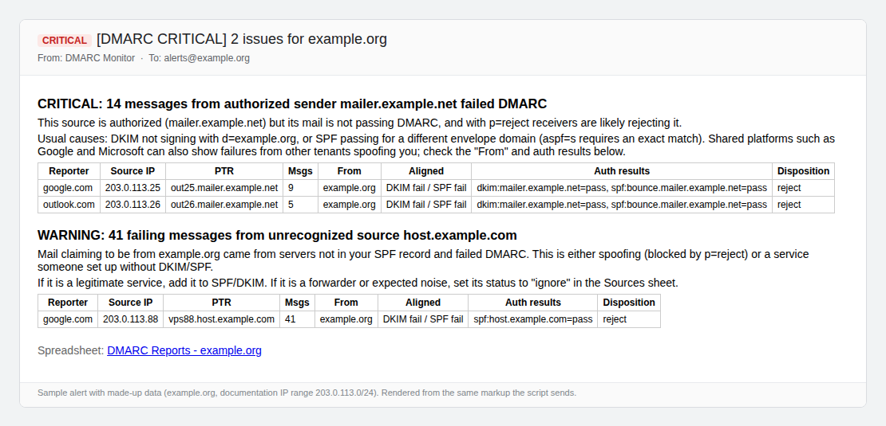

# DMARC Monitor for example.org

A Google Apps Script that runs as a dedicated account, `dmarc-bot@example.org`.
That account is a member of the `emailadmin@example.org` Google Group, so it
receives every DMARC aggregate report sent to the group. Every hour the script:

1. Finds new report emails (labeled `DMARC` by a Gmail filter).
2. Unpacks the `.zip` / `.gz` / `.xml` attachments and parses the reports.
3. Writes reports and records to a Google Sheet.
4. Matches each source IP against everything your SPF record authorizes (looked
   up live, including `include:`s) and its reverse-DNS name.
5. Emails alerts when something is wrong.

No mail leaves Google. The only outside calls are DNS lookups to `dns.google`.

For architecture, data model, alert rules and operations, see the
[system document](docs/SYSTEM.md).

*A sample alert email. The data is made up: `example.org` and the reserved documentation range `203.0.113.0/24`.*

## Alerts

| Severity | When | What it usually means |
|---|---|---|
| CRITICAL | An **authorized** sender (in SPF, e.g. Google, Microsoft, Mailgun) fails DMARC on ≥ 3 messages | Real mail is being rejected (`p=reject`). DKIM isn't signing as example.org, or SPF passes for a different envelope domain. `aspf=s` requires an exact match. |
| WARNING | An **unrecognized** source fails DMARC on ≥ 25 messages | Spoofing (already blocked), or a service someone set up without DKIM/SPF |
| WARNING | Overall fail rate ≥ 10% (at least 100 messages in the run) | Broad problem |
| WARNING | A report shows a published policy other than `p=reject; sp=reject; pct=100` | The `_dmarc` DNS record changed |
| WARNING | No new reports for 3 days | DNS, group membership or filter broken |
| NOTICE | A source never seen before is **passing** DMARC | A new service holds your DKIM key or SPF authorization. Make sure that's intended. Not sent during the first 7 days after setup. |

The same alert isn't repeated within 24 hours. Reports older than 10 days are
stored but never alert, so backlogs don't cause an alert flood. A weekly
summary goes out Monday at 8am. All thresholds are in `src/Config.gs`.

### The Sources sheet

Each sending organization gets one row, grouped by the base domain of its
reverse-DNS name, or by `/24` when it has none. The `status` column is yours to edit:

- `approved`: treat it as an authorized sender, and stop "new sender" notices.
- `ignore`: never alert on it (e.g. a mailing list or forwarder that always breaks DKIM).

## Setup

### 1. Create the account (Google Admin console)
- Add the user **dmarc-bot@example.org**. Enforce 2-step verification. It only needs Gmail, Sheets and Apps Script.
- Make sure Apps Script is enabled for the account's org unit.

### 2. Add it to the group
- groups.google.com → **emailadmin** → Members → Add `dmarc-bot@example.org`.
- Set its subscription to **Each email**. Digests and "no email" break this.
- Group settings to check: **Who can post** must allow external senders
  (report senders are google.com, outlook.com and so on). **Moderation** and
  **spam handling** must not hold report messages.

### 3. Import the Gmail filter (signed in as dmarc-bot)
Gmail → Settings (gear) → **See all settings** → **Filters and Blocked Addresses** →
**Import filters** → choose `gmail-filter.xml` (your copy of `gmail-filter.example.xml`) → **Open file** → tick
**Apply new filters to existing email** → **Create filters**.

The filter matches `list:emailadmin.example.org {filename:zip filename:gz filename:xml}`.
It applies the label `DMARC` (created if missing), skips the inbox and never sends to spam.

### 4. Install the script (signed in as dmarc-bot)
1. Go to https://script.google.com → **New project** and name it "DMARC Monitor".
2. Project Settings (gear icon) → tick **Show "appsscript.json" manifest file in editor**.
   A file named `appsscript.json` then appears in the file list. Replace its contents with
   `src/appsscript.json`. Don't create it yourself with **+** → Script, because that makes a
   `.gs` file and JSON in a `.gs` file is a syntax error that blocks saving.
3. Copy `src/Config.example.gs` to `src/Config.gs` and `gmail-filter.example.xml` to
   `gmail-filter.xml`, and replace `example.org` and the alert address with your own
   (both copies are git-ignored). Then create a script file for each of `Config`, `Main`, `Parse`, `Dns`, `Store`
   and `Alerts`, and paste in the matching `src/*.gs` file. Delete the default `Code.gs`.
4. Check `alertRecipients` in `Config.gs`. `setup()` stops with an error if it's ever set back to the `CHANGE_ME` placeholder.
5. Select `setup` in the function dropdown → **Run**, and approve the permissions.
   It creates the labels, the "DMARC Reports - example.org" spreadsheet and the triggers.
   Find the spreadsheet link under **Executions** → setup → logs.
6. Select `processReports` → **Run** to process what's waiting. Each run handles up
   to 40 threads, so run it a few times if there's a backlog, or just let the hourly trigger work through it.

To push from this folder instead of pasting, use [clasp](https://github.com/google/clasp):
`clasp login`, `clasp create --type standalone --rootDir src`, `clasp push`.

### 5. Check it
- The spreadsheet's `Reports` and `Records` tabs fill up.
- Threads in Gmail move from `DMARC` to `DMARC/processed`.
- `DMARC/error` holds reports that failed to parse; see Apps Script → Executions for the error.
  `DMARC/unparsed` holds messages that had no aggregate report, such as forensic (`ruf`) reports.

## Privacy and security
- **Keep the spreadsheet private.** It holds source IPs, reverse-DNS names and which services send as your domain, which is useful reconnaissance for an attacker. Share it only with the people who need it, and never "anyone with the link".
- Report fields come from outside email and DNS, so they are untrusted. Before anything is written to Sheets, any text starting with `=`, `+`, `-` or `@` gets a leading apostrophe so it is stored as literal text and can't run as a formula (`safeCell_` in `src/Store.gs`). Alert emails are HTML-escaped.
- Your real domain, addresses and spreadsheet ID live only in the git-ignored files `src/Config.gs`, `gmail-filter.xml` and `STATUS.md`. Don't commit them.

## Notes and limits
- History starts when dmarc-bot joins the group. Earlier reports aren't in its mailbox.
- Shared platforms (Google, Microsoft) are in everyone's SPF. A CRITICAL from
  `google.com` can therefore be another Google tenant spoofing you rather than your own
  mail failing. The alert shows the auth results so you can tell which.
- Reverse DNS is limited to 150 new lookups per run and cached in the `PtrCache` tab.
  The SPF expansion is cached for 6 hours.
- Sheets holds up to 10 million cells. At about 18 cells per record, that's
  years of reports for a domain this size. Delete old `Records` rows if it ever gets close.
